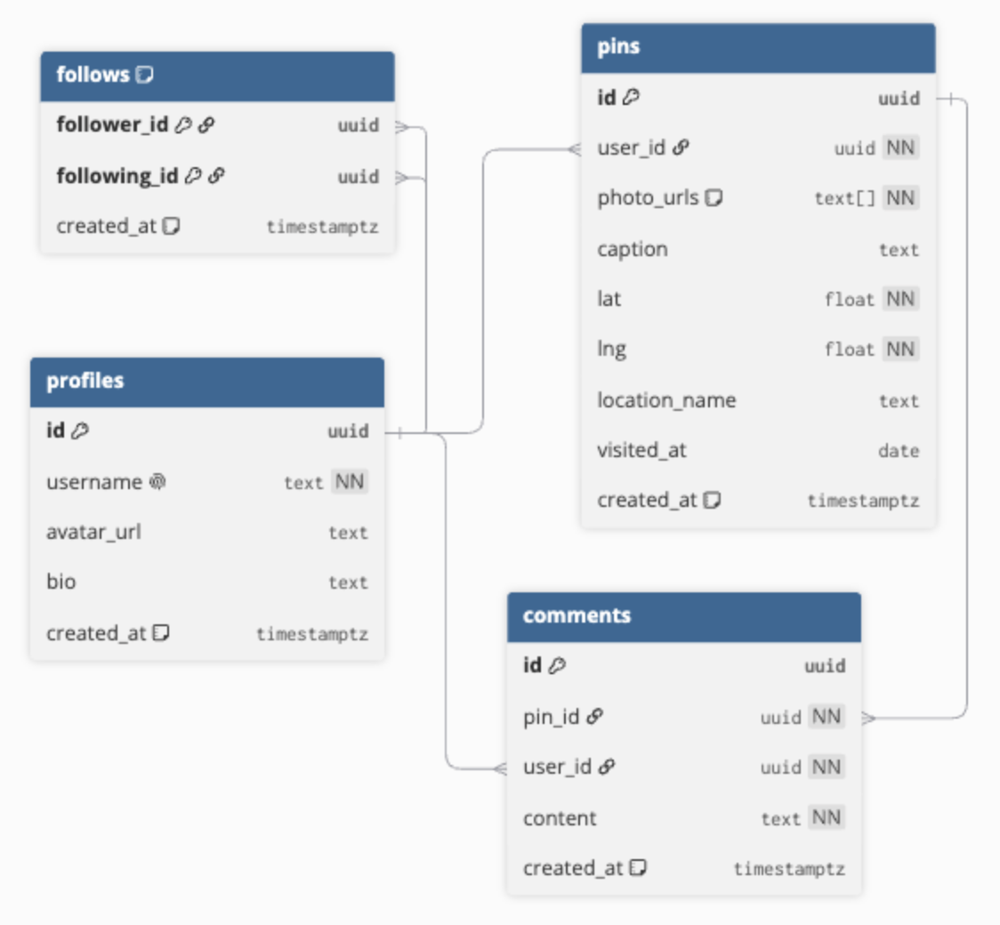

# Photo Log

A map-based photo journal. Pin your photos to the places you took them, browse your posts on an interactive map, and revisit them through a paginated feed. **Scope** Single-user for now. Pins are private to each account; sharing and social features are on the roadmap.

**[Live Demo](https://photo-log-alpha.vercel.app/)** - Click "Try the demo" to explore without creating the account (read-only).

## Features

- Create pins with multiple photos, a caption, a date, and a location (searchable)
- Split-view map and feed: the interactive map shows every pin, the feed loads details page by page via cursor pagination
- Photos are compressed in the browser before upload, so large images stay under server limits
- Email and GitHub auth, plus a read-only demo account

## Tech Stack

- Next.js (App Router)
- Supabase (Postgres, Auth, Storage, Row Level Security)
- Zustand
- Mapbox GL
- Tailwind CSS
- Vitest
- Playwright

## Notable Details

- Row Level Security on tables and storage so users can only modify their own data
- Deleting a pin removes its files from Storage, not just the database row
- E2E test covers login -> upload -> delete, and cleans up after itself

## Getting Started

1. `git clone https://github.com/seneyu/photo-log.git && cd photo-log`
2. `npm install`
3. Create a Supabase project and run `supabase/schema.sql`. (Create a public `photo-uploads` bucket and add storage policies, if the schema doesn't.)
4. Enable the GitHub provider in Supabase Auth and add your callback URL.
5. Copy the env vars below into `.env.local`.
6. `npm run dev`

Create a `.env.local` file with:

```
NEXT_PUBLIC_SUPABASE_URL=                       # Supabase -> Project Settings -> API
NEXT_PUBLIC_SUPABASE_PUBLISHABLE_KEY=
NEXT_PUBLIC_SITE_URL=http://localhost:3000
GITHUB_CLIENT_ID=                               # GitHub OAuth app
GITHUB_SECRET=
NEXT_PUBLIC_MAPBOX_TOKEN=                       # mapbox.com account
DEMO_ACCOUNT_EMAIL=                             # an existing read-only user
DEMO_ACCOUNT_PASSWORD=
PLAYWRIGHT_TESTING_EMAIL=                       # an existing test user
PLAYWRIGHT_TESTING_PASSWORD=
```

## Testing

```bash
npm run test                # unit tests (Vitest)
npx playwright test         # E2E, needs the test account above
```

## Data Model


